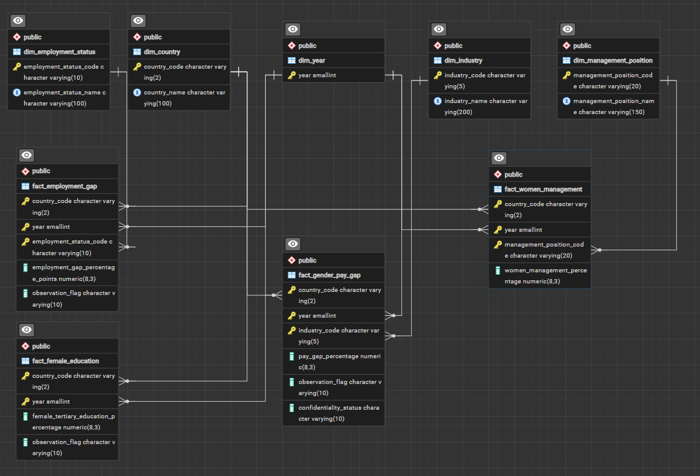

# **GENDER PAY GAP ANALYSIS**
### **Resource**: 
[Eurostat](https://ec.europa.eu/eurostat/databrowser/explore/all/tb_eu?sort=category&lang=en&subtheme=sdg.sdg_05&display=list)
### Team: 
**Data Engineer**: Khoizuron Syakira

**Database & Data Modeling**: Muhammad Rizqy Fadillah

**Data Analyst**: Guntur Rizkiyana Muhammad
## **Background**
Kesetaraan gender merupakan pilar utama agenda pembangunan berkelanjutan Uni Eropa (SDG 5), namun kesenjangan upah antar-gender (Gender Pay Gap) masih menjadi tantangan di berbagai sektor industri. Analisis ini menggunakan data resmi Eurostat (2015–2024) untuk memetakan disparitas upah lintas sektor serta menguji pengaruh tingkat pendidikan tinggi, partisipasi kerja, dan kepemimpinan manajerial perempuan guna menghasilkan rekomendasi kebijakan berbasis data.

## Stakeholder

Proyek ini melibatkan berbagai stakeholder yang memiliki peran dalam dalam meregulasi dan menekan Gender Pay Gap

| Stakeholder | Peran |
|---|---|
| **Pembuat Kebijakan & Regulator Uni Eropa** | Merumuskan regulasi transparansi upah lintas industri (seperti EU Pay Transparency Directive), mengalokasikan anggaran beasiswa pendidikan tinggi bagi perempuan, serta merancang insentif pajak/regulasi bagi perusahaan yang meningkatkan kuota kepemimpinan perempuan | 
| **Pimpinan Perusahaan** | Mengevaluasi struktur kompensasi (gaji pokok, bonus, dan promosi), menghilangkan bias gender dalam jenjang karier, serta membuka akses lebih luas bagi perempuan ke posisi manajerial. | 
| **Institusi Pendidikan Tinggi & Lembaga Pelatihan** | Mendorong partisipasi mahasiswi di bidang-bidang strategis dan berpenghasilan tinggi (seperti keuangan, teknologi, dan manajemen bisnis). |
| **European Institute for Gender Equality / EIGE** | Mendapatkan transparansi informasi mengenai standar pengupahan di tiap sektor industri dan memperjuangkan kesetaraan hak serta peluang promosi di tempat kerja. | 


## **Data Engineering (Pipeline & Infrastructure)**
### Data Engineering Pipeline

Alur kerja *data engineering* dirancang secara *end-to-end* untuk mengotomatisasi pengambilan data dari API resmi Eurostat, pembersihan data terdistribusi menggunakan PySpark, validasi kualitas data dengan Great Expectations, hingga pemuatan data ke PostgreSQL (*Star/Galaxy Schema*) dan MongoDB Atlas:

#### 1. Alur Proses Pipeline (ETL & Validation)
Alur eksekusi pipeline berjalan secara berurutan dengan gerbang validasi kualitas sebelum pemuatan ke database produksi:
`extract` → `transform` → `validate_gx` → `[load_postgres, load_mongo]`

- **Extraction (`extract.py`)**:
  - Mengunduh 4 dataset mentah periode 2015–2024 langsung dari **Eurostat SDMX 3.0 API** dalam format CSV terkompresi (`.csv.gz`) ke direktori `/workspace/data/gp/raw`:
    1. `wage_gap.csv.gz` (`earn_gr_gpgr2`): Kesenjangan upah berdasarkan 17 sektor industri NACE Rev. 2 (`B`–`R`) di 36 negara.
    2. `emp_gap.csv.gz` (`sdg_05_30`): Kesenjangan tingkat pekerjaan usia 20–64 tahun berdasarkan 4 status kerja (`EMP`, `EMP_PT`, `EMP_TEMP`, `UEMP_PT`) di 35 negara.
    3. `women_mang.csv.gz` (`sdg_05_61`): Proporsi perempuan di posisi manajemen (`NEXEC`, `NEXEC_EXEC`) di 34 negara.
    4. `women_college.csv.gz` (`sdg_04_20`): Persentase perempuan usia 25–34 tahun berpendidikan tinggi (ISCED 5–8) di 36 negara.
  - Dilengkapi mekanisme *auto-retry* hingga 3 kali percobaan dengan jeda bertahap (`5s`, `10s`, `15s`), *timeout* 120 detik, serta pengecekan respons kosong agar proses unduh tahan terhadap gangguan jaringan.

- **Transformation (`transform.py`)**:
  - Memproses seluruh file mentah menggunakan **PySpark (`pyspark==4.2.1`)** dan menyimpannya ke `/workspace/data/gp/clean/*_clean.csv`.
  - **Standarisasi Skema**: Menyeragamkan nama kolom mentah menjadi `snake_case` (`to_snake_case()`) dan memetakannya agar identik dengan `schema.sql` (`pay_gap_percentage`, `employment_gap_percentage_points`, `women_management_percentage`, `female_tertiary_education_percentage`, serta kolom kode dan nama dimensi).
  - **Pembersihan & Normalisasi**: Menghapus duplikasi (`dropDuplicates()`), membulatkan metrik ke 2 angka di belakang koma, menghapus spasi berlebih (`trim`), menerapkan format `initcap` pada nama negara, status kerja, serta posisi manajemen, dan mengurutkan data berdasarkan *Primary Key*.
  - **Pelacakan Imputasi (`is_imputed`)**: Menandai baris yang nilai aslinya kosong (`obs_value IS NULL`) melalui kolom boolean `is_imputed` sebelum nilai numerik kosong diisi `0` dan teks wajib yang kosong diisi `'Unknown'`, sementara kolom *flag* (`observation_flag`, `confidentiality_status`) tetap dibiarkan kosong jika memang tidak ada catatan dari Eurostat.

- **Data Validation (`validate.py`)**:
  - Menerapkan *automated quality gate* menggunakan **Great Expectations (`great-expectations==1.24.1`)** sebelum data masuk ke database produksi dan menyimpan laporan audit ke `/workspace/data/gp/reports/quality_report.csv`.
  - **Validasi Tabel Fakta & Dimensi**: Memverifikasi kelengkapan kolom wajib, ketepatan jumlah baris dan jumlah baris imputasi (`wage_gap`: 4.829 baris / 33 imputed; `emp_gap`: 1.360 baris / 7 imputed; `women_mang`: 664 baris / 0 imputed; `women_college`: 345 baris / 0 imputed), format 2 huruf kapital pada `country_code` (`^[A-Z]{2}$`), kelengkapan tahun `2015–2024` bertipe integer, rentang nilai persentase yang wajar, batas panjang karakter `VARCHAR` sesuai `schema.sql`, keunikan *Composite Primary Key*, serta konsistensi pemetaan *1-to-1* antara kode dan nama pada tabel dimensi.
  - **Mekanisme Fail-Safe**: Jika terdapat satu saja aturan yang gagal, `validate.py` keluar dengan kode `sys.exit(1)` sehingga *task* `load_postgres` dan `load_mongo` otomatis tidak dijalankan. Tersedia pula mode uji gagal melalui variabel `VALIDATE_FORCE_FAIL=true`.

- **Loading & Database Provisioning (`load.py`)**:
  - **PostgreSQL Data Warehouse (`dwh_gp`)**:
    - Memuat data ke 4 tabel dimensi (`dim_country`: 37 baris, `dim_industry`: 17 baris, `dim_employment_status`: 4 baris, `dim_management_position`: 2 baris, serta memastikan `dim_year`: 10 baris) dan 4 tabel fakta (`fact_gender_pay_gap`: 4.829 baris, `fact_employment_gap`: 1.360 baris, `fact_women_management`: 664 baris, `fact_female_education`: 345 baris).
    - Berjalan secara idempoten dalam satu transaksi atomik (`engine.begin()`): menjalankan `TRUNCATE TABLE` serentak, mengisi tabel dimensi terlebih dahulu sebelum tabel fakta demi menjaga integritas *Foreign Key*, mengembalikan baris berstatus `is_imputed = True` menjadi `NULL` (`IMPUTED_AS_NULL = True`) agar perhitungan agregasi `AVG()` di SQL akurat, serta memverifikasi jumlah baris akhir (`SELECT COUNT(*)`).
  - **MongoDB Atlas (`gender_pay_gap`)**:
    - Memuat 4 koleksi dokumen (`wage_gap`, `emp_gap`, `women_mang`, `women_college`) secara idempoten dengan mempertahankan atribut `is_imputed` untuk kebutuhan audit, mengonversi string kosong menjadi `null`, memasang *unique index* (`unique=True`) pada *Primary Key* tiap koleksi untuk mencegah duplikasi dokumen, serta memverifikasi jumlah dokumen (`count_documents({})`).

#### 2. Airflow Orchestration
- **DAG Structure**: Menggunakan 1 DAG (`gender_pay_gap_pipeline` pada `/workspace/dags/finalproject_group2_gp_DAG.py`) dengan 5 *task*: `extract` → `transform` → `validate_gx` → `load_postgres` dan `load_mongo` (keduanya berjalan paralel).
- **Execution & Dependency**: Dijalankan menggunakan `BashOperator` dengan `append_env=True` untuk meneruskan konfigurasi `.env` dan *path* direktori kerja, serta `trigger_rule="all_success"` pada *task* `load_postgres` dan `load_mongo` agar pemuatan hanya berjalan jika `validate_gx` lolos seluruh pengecekan.
- **Schedule & Concurrency**: Dijadwalkan berjalan otomatis setiap hari Senin pukul 06.00 WIB (`SCHEDULE_CRON = "0 6 * * 1"`, zona waktu `Asia/Jakarta`) dengan konfigurasi `catchup=False` dan `max_active_runs=1`.
- **Retry Policy**: Konfigurasi otomatis 1 kali percobaan ulang (`retries=1`) dengan jeda 1 menit (`retry_delay=timedelta(minutes=1)`) jika terjadi kegagalan pada *task*.

#### 3. Environment & Infrastructure
- **Container & Python Environment**: Pipeline berjalan di dalam *container* Docker Apache Airflow dengan lingkungan Python 3.13 dan dependensi utama pada `requirements.txt` (`great-expectations==1.24.1`, `pyspark==4.2.1`, `pymongo`, `psycopg2-binary`, `asyncpg`, `sqlalchemy`, `pandas>=2.2.3,<3`, `python-dotenv`).
- **Storage & Credential Management**: Data mentah, data bersih, dan laporan kualitas disimpan secara terstruktur di `/workspace/data/gp/{raw,clean,reports}`, sementara seluruh kredensial koneksi database (`PG_HOST`, `PG_PORT`, `PG_DB`, `PG_USER`, `PG_PASSWORD`, `MONGO_URI`, `MONGO_DB`) disimpan terpisah pada file `.env` yang dikecualikan dari repositori Git.


Database dirancang menggunakan pendekatan *Dimensional Modeling* dengan memisahkan data pengukuran ke dalam *Fact Tables* dan informasi kategoris ke dalam *Dimension Tables*. Pemisahan ini bertujuan untuk mengurangi redundasi data, menjaga integritas relasional, serta memudahkan proses analisis dan visualisasi.
#### Database Architecture 

Arsitektur basis data dirancang menggunakan *Galaxy Schema*, yang terdiri dari:
* **Fact Tables**: Menyimpan metrik utama yang digunakan dalam analisis, meliputi:
  * `fact_gender_pay_gap`: Menyimpan persentase kesenjangan upah berdasarkan negara, tahun, dan industri.
  * `fact_employment_gap`: Menyimpan kesenjangan tingkat pekerjaan antara laki-laki dan perempuan berdasarkan negara, tahun, dan status pekerjaan.
  * `fact_female_education`: Menyimpan persentase perempuan berusia 25–34 tahun yang memiliki pendidikan tinggi.
  * `fact_women_management`: Menyimpan persentase perempuan yang menduduki posisi manajemen.
* **Dimension Tables**: Menyimpan informasi kategoris sebagai referensi untuk Fact Tables, meliputi:
  * `dim_country`: Kode dan nama negara.
  * `dim_year`: Tahun pengamatan selama periode 2015–2024.
  * `dim_industry`: Klasifikasi industri berdasarkan NACE Rev. 2.
  * `dim_employment_status`: Kategori status pekerjaan.
  * `dim_management_position`: Kategori posisi manajemen.
### Data Preparation
#### Data Type Formatting & Integrity
* **Data Type Formatting**: Menyesuaikan tipe data berdasarkan karakteristik masing-masing kolom. Kode negara dan kategori menggunakan `VARCHAR`, tahun menggunakan `SMALLINT`, sedangkan nilai persentase dan metrik numerik menggunakan `NUMERIC(8,3)`.

* **Primary Key**: Menggunakan *Natural Key* untuk Dimension Tables, seperti `country_code`, `year`, dan kode kategori. Fact Tables menggunakan *Composite Primary Key* berdasarkan kombinasi kolom yang membentuk identitas unik setiap observasi.

* **Foreign Key**: Menerapkan relasi antara Fact Tables dan Dimension Tables untuk menjaga konsistensi referensi data.

### SQL & Analytics
Untuk mendukung kebutuhan analisis dan menjawab lima pertanyaan penelitian (*Key Questions*), dirancang SQL Queries dan *SQL Views* yang menghubungkan Fact Tables dengan Dimension Tables.

Penggunaan *SQL Views* bertujuan menyederhanakan proses pengambilan data, mengurangi pengulangan sintaks `JOIN`, serta menyediakan struktur data yang lebih mudah digunakan oleh tim Analyst & Dashboard.

Beberapa kebutuhan analisis yang didukung meliputi:

1. **Gender Pay Gap Trend**: Menganalisis perkembangan kesenjangan upah berdasarkan industri selama 2015–2024.
2. **Industry Comparison**: Membandingkan tingkat kesenjangan upah antarindustri.
3. **Education and Pay Gap Relationship**: Menggabungkan data pendidikan perempuan dengan gender pay gap untuk analisis hubungan statistik.
4. **Employment Gap Analysis**: Mengidentifikasi kesenjangan tingkat pekerjaan antara laki-laki dan perempuan.
5. **Women in Management**: Menganalisis persentase perempuan dalam posisi manajemen.

Contoh implementasi SQL View untuk menampilkan detail Gender Pay Gap berdasarkan negara, tahun, dan industri:

```sql
CREATE OR REPLACE VIEW public.vw_gender_pay_gap_detail AS
SELECT
    c.country_code,
    c.country_name,
    y.year,
    i.industry_code,
    i.industry_name,
    f.pay_gap_percentage,
    f.observation_flag,
    f.confidentiality_status
FROM public.fact_gender_pay_gap f
JOIN public.dim_country c
    ON f.country_code = c.country_code
JOIN public.dim_year y
    ON f.year = y.year
JOIN public.dim_industry i
    ON f.industry_code = i.industry_code;
```
## **Data Dictionary**

#### A. COUNTRY

| Column | Data Type | Definisi |
|---|---|---|
| `country_code` | varchar(2) | Primary key yang menjadi identitas unik setiap negara berdasarkan kode Eurostat |
| `country_name` | varchar(100) | Nama lengkap negara berdasarkan kode negara Eurostat |

---

#### B. YEAR

| Column | Data Type | Definisi |
|---|---|---|
| `year` | SMALLINT | Primary key yang menyimpan tahun pengamatan dari 2015 sampai 2024 |

---

#### C. INDUSTRY

| Column | Data Type | Definisi |
|---|---|---|
| `industry_code` | varchar(5) | Primary key yang menjadi identitas unik setiap kategori industri berdasarkan kode NACE Rev. 2 |
| `industry_name` | varchar(200) | Nama atau deskripsi kategori industri berdasarkan klasifikasi NACE Rev. 2 |

---

#### D. EMPLOYMENT STATUS

| Column | Data Type | Definisi |
|---|---|---|
| `employment_status_code` | varchar(10) | Primary key yang menjadi identitas unik setiap kategori status pekerjaan berdasarkan kode Eurostat |
| `employment_status_name` | varchar(100) | Nama atau deskripsi kategori status pekerjaan, seperti employed persons, part-time workers, dan temporary workers |

---

#### E. MANAGEMENT POSITION

| Column | Data Type | Definisi |
|---|---|---|
| `management_position_code` | varchar(20) | Primary key yang menjadi identitas unik setiap kategori posisi manajemen berdasarkan kode Eurostat |
| `management_position_name` | varchar(150) | Nama atau deskripsi kategori posisi manajemen, seperti non-executive directors dan non-executives and executive directors |

---

#### F. GENDER PAY GAP

| Column | Data Type | Definisi |
|---|---|---|
| `country_code` | varchar(20) | Foreign Key yang menghubungkan data gender pay gap dengan tabel dim_country berdasarkan kode negara |
| `year` | SMALLINT | Foreign Key yang menghubungkan data gender pay gap dengan tabel dim_year berdasarkan tahun pengamatan |
| `industry_code` | varchar(5) | Foreign Key yang menghubungkan data gender pay gap dengan tabel dim_industry berdasarkan kode industri |
| `pay_gap_percentage` | numeric(8,3) | Menyimpan nilai persentase kesenjangan upah antara laki-laki dan perempuan pada suatu industri |
| `observation_flag` | varchar(10) | Menyimpan kode penanda atau status tambahan yang diberikan Eurostat pada suatu observasi |
| `confidentiality_status` | varchar(10) | Menunjukkan status kerahasiaan data berdasarkan kode yang diberikan Eurostat |

---

#### G. EMPLOYMENT GAP

| Column | Data Type | Definisi |
|---|---|---|
| `country_code` | varchar(20) | Foreign Key yang menghubungkan data employment gap dengan tabel dim_country berdasarkan kode negara |
| `year` | SMALLINT | Foreign Key yang menghubungkan data employment gap dengan tabel dim_year berdasarkan tahun pengamatan |
| `employment_status_code` | varchar(10) | Foreign Key yang menghubungkan data employment gap dengan tabel dim_employment_status berdasarkan kategori status pekerjaan |
| `employment_gap_percentage_points` | numeric(8,3) | Menyimpan nilai kesenjangan tingkat pekerjaan antara laki-laki dan perempuan dalam satuan percentage points |
| `observation_flag` | varchar(10) | Menyimpan kode penanda atau status tambahan yang diberikan Eurostat pada suatu observasi |

---

#### H. FEMALE EDUCATION

| Column | Data Type | Definisi |
|---|---|---|
| `country_code` | varchar(20) | Foreign Key yang menghubungkan data pendidikan perempuan dengan tabel dim_country berdasarkan kode negara |
| `year` | SMALLINT | Foreign Key yang menghubungkan data pendidikan perempuan dengan tabel year berdasarkan tahun pengamatan |
| `female_tertiary_education_percentage` | numeric(8,3) | Menyimpan persentase perempuan berusia 25–34 tahun yang telah menyelesaikan pendidikan tinggi berdasarkan klasifikasi ISCED 5–8 |
| `observation_flag` | varchar(10) | Menyimpan kode penanda atau status tambahan yang diberikan Eurostat pada suatu observasi |

---

#### I. WOMEN MANAGEMENT

| Column | Data Type | Definisi |
|---|---|---|
| `country_code` | varchar(20) | Foreign Key yang menghubungkan data perempuan dalam manajemen dengan tabel country berdasarkan kode negara |
| `year` | SMALLINT | Foreign Key yang menghubungkan data perempuan dalam manajemen dengan tabel year berdasarkan tahun pengamatan |
| `management_position_code` | varchar(20) | Foreign Key yang menghubungkan data perempuan dalam manajemen dengan tabel dim_management_position berdasarkan kategori posisi manajemen |
| `women_management_percentage` | numeric(8,3) | Menyimpan persentase perempuan yang menduduki posisi manajemen berdasarkan kategori posisi profesional |

## **Problem Statement**
"Meskipun tingkat pendidikan tinggi dan partisipasi kerja perempuan di kawasan Eropa terus meningkat selama periode 2015–2024, kesenjangan upah antar-gender (Gender Pay Gap) masih ada. Tanpa pemetaan empiris mengenai sektor yang paling terdampak serta pengujian statistik terhadap faktor-faktor pendorongnya—seperti tingkat pendidikan tinggi, selisih partisipasi kerja (employment gap), dan keterwakilan perempuan di posisi manajerial—pembuat kebijakan Uni Eropa berisiko merumuskan intervensi yang kurang tepat sasaran dalam mempercepat kesetaraan upah."


## **Key Questions**
1. Bagaimana tren gender pay gap di Eropa seiring waktu? 
2. Berdasarkan Industri, bagaimana perbandingan gender pay gap? Secara statistik, apakah perbedaan antar industri ini nyata atau hanya kebetulan?
3. Bagaimana trend tingkat edukasi wanita? Serta apa pengaruhnya terhadap gender pay gap?
4. Bagaimana tren persentase gap employment antara gender? Bagaimana pengaruhnya terhadap gender pay gap?
5. Bagaimana perkembangan tren persentase wanita masuk menjabat dalam manajemen suatu perusahaan? Bagaimana pengaruhnya terhadap gender pay gap?


## **Key Performance Indicators (KPI)**
**1. Exploitation Rate**<br>
**Explanation:** Mengukur persentase korban yang mengalami forced labour dari total korban.<br>
**Purpose:** Mengetahui proporsi keseluruhan korban yang mengalami eksploitasi.
  
**2. Forced Labour Rate**<br>
**Explanation:** Mengukur persentase korban yang mengalami forced labour dari total korban.<br>
**Purpose:** Mengidentifikasi seberapa sering kasus kerja paksa terjadi dalam dataset ini. 
  
**3. Sexual Exploitation Rate**<br>
**Explanation:** Mengukur persentase korban yang mengalami sexual exploitation dari total korban.<br>
**Purpose:** Mengetahui seberapa besar proporsi korban yang mengalami eksploitasi seksual.
  
**4. Debt Bondage Rate**<br>
**Explanation:** Mengukur persentase korban yang mengalami debt bondage dari total korban.<br>
**Purpose:** Mengidentifikasi tingkat eksploitasi yang berkaitan dengan keterikatan utang.
  
**5. Document Withholding Rate**<br>
**Explanation:** Mengukur persentase korban yang mengalami penahanan atau penyitaan dokumen dari total korban.<br>
**Purpose:** Mengetahui seberapa sering terjadi penahanan dokumen sebagao salah satu indikator resiko eksploitasi.
  
**6. High-Risk Sector Agriculture**<br>
**Explanation:** Mengukur exploitation rate khusus pada korban yang bekerja di sektor Agriculture.<br>
**Purpose:** Mengidentifikasi apakah sektor Agricukture merupakan sektor dengan resiko eksploitasi yang tinggi.
  
**7. High-Risk Age**<br>
**Explanation:** Menemukan kelompok usia dengan exploitation rate tertinggi.<br>
**Purpose:** Mengidentifikasi kelompok usia yang paling rentan terhadap eksploitasi.
  
**8. High-Risk Citizenship**<br>
**Explanation:** Mengukur exploitation rate berdasarkan kewarganegaraan korban.<br>
**Purpose:** Mengidentifikasi kelompok kewarganegaraan dengan tingkat resiko eksploitasi tertinggi.
  
**9. Recruitement Risk**<br>
**Explanation:** Mengukur exploitation rate berdasarkan recruitment relationship atau hubungan antara korban dan pihak yang merekrutnya.<br>
**Purpose:** Mengidentifikasi pola hubungan rekrutmen yang memiliki tingkat resiko eksploitasi lebih tinggi.

## **Findings**
**KQ1**. Risiko eksploitasi sangat dipengaruhi gender dan usia, perempuan (khususnya anak 09–17 tahun) dominan mengalami eksploitasi seksual, sementara laki-laki dominan mengalami kerja paksa, dengan pola yang juga bervariasi menurut kewarganegaraan.<br>
**KQ2.** Setiap sektor memiliki "signature" eksploitasi yang khas dan hampir murni satu jenis seperti sektor seks (prostitusi, pornografi) hampir eksklusif eksploitasi seksual, sektor kerja fisik (agriculture, construction) hampir eksklusif kerja paksa, kecuali hospitality yang menunjukkan risiko ganda.<br>
**KQ3.** Relasi personal yang dekat (intimate partner, family) justru berkorelasi dengan rate eksploitasi seksual tertinggi, sedangkan relasi non-personal ("other"/agen) lebih berkorelasi dengan kerja paksa  membalikkan asumsi umum bahwa orang asing adalah ancaman utama.<br>
**KQ4.** Anak perempuan yang direkrut melalui relasi dekat memiliki risiko eksploitasi seksual paling ekstrem, sementara anak laki-laki menunjukkan pola eksploitasi yang lebih campuran antara kerja paksa dan seksual.<br>
**KQ5.** Profil korban dengan risiko paling ekstrem adalah kombinasi anak usia sangat muda, sektor eksploitasi seksual, dan direkrut oleh keluarga sendiri seperti menunjukkan bahwa kombinasi faktor demografis, sektor, dan relasi recruiter jauh lebih prediktif dibanding faktor tunggal manapun.<br>
**KQ6**. Berdasarkan uji statistik Spearman ($\rho = 0,7204$; $p = 0,000106$), jumlah korban dengan hubungan rekrutmen Other menunjukkan tren peningkatan jangka panjang yang signifikan dengan puncak tertinggi pada 2016, sementara kategori Family, Friend, dan Intimate Partner masing-masing mencapai puncaknya pada 2016 atau 2019 sebelum mengalami penurunan hingga tahun 2024.

## **Conclusion**
1. Overall, perkembangan Gender Pay Gap menujukkan trend positif (membaik) dengan terus menurun seiring waktu
2. Industri bisnis dan servis mencatat Gender Pay Gap tertinggi. Gap terendah ada pada industri yang berkutat pada operasional lapangan.
3. Perbedaan pay gap antar industri signifikan secara statistik sehingga jenis industri mempengaruhi besarnya Gender Pay Gap
4. Tingkat edukasi tinggi, gender gap employment dan persentase wanita dalam posisi manajemen menunjukkan tren perkembangan positif (membaik) selama 10 tahun.
5. Tingkat edukasi tinggi dan persentase wanita dalam posisi manajemen memiliki korelasi dan signifikan secara statistik dalam menurunkan Gender Pay Gap. Sedangkan gender gap employment tidak memiliki korelasi dan signifikansi secara statistik. 

## **Recommendation**
Untuk menurunkan Gender Pay Gap dengan efektif, pemerintah Uni Eropa dapat merumuskan kebijakan sebagai berikut:

1. Regulasi Upah Industri: Menerapkan standar pelaporan kesenjangan upah berkala pada industri guna mengatur dan menekan ketimpangan upah, bonus dan jenjang karier.
2. Perluasan Akses Pendidikan Tinggi: Memperluas beasiswa dan akses pendidikan tinggi bagi wanita.
3. Insentif Kepemimpinan Manajerial: Memberikan insentif bagi perusahaan yang meningkatkan persentase perempuan di jajaran manajerial.

### cara run
1. **Persiapan Database & Koneksi (`.env`)**:
   - Buat database `dwh_gp` di PostgreSQL dan jalankan file DDL `schema.sql` untuk membentuk tabel dimensi dan fakta.
   - Pastikan *IP Access List* pada MongoDB Atlas sudah mengizinkan koneksi masuk.
   - Salin `.env.example` menjadi `.env` di folder root Airflow, lalu isi kredensial koneksi database:
     ```env
     PG_HOST=host.docker.internal
     PG_PORT=5432
     PG_DB=dwh_gp
     PG_USER=<username_postgres>
     PG_PASSWORD=<password_postgres>
     MONGO_URI=<mongodb_atlas_connection_string>
     MONGO_DB=gender_pay_gap
     ```
2. **Menjalankan Melalui Apache Airflow (Otomatis / Trigger Manual)**:
   - Pastikan file DAG `finalproject_group2_gp_DAG.py` berada di `/workspace/dags/` dan seluruh script ETL (`extract.py`, `transform.py`, `validate.py`, `load.py`) berada di `/workspace/scripts/gp/`.
   - Aktifkan (*unpause*) DAG **`gender_pay_gap_pipeline`** di UI Airflow. Pipeline akan berjalan otomatis setiap hari Senin pukul 06.00 WIB atau dapat dijalankan langsung melalui tombol **Trigger DAG**.
3. **Menjalankan Manual di Dalam Container**:
   ```bash
   cd /workspace/scripts/gp
   source set_env.sh
   python extract.py
   python transform.py
   python validate.py
   python load.py          # memuat ke PostgreSQL dan MongoDB sekaligus (atau gunakan: load.py postgres / load.py mongo)
